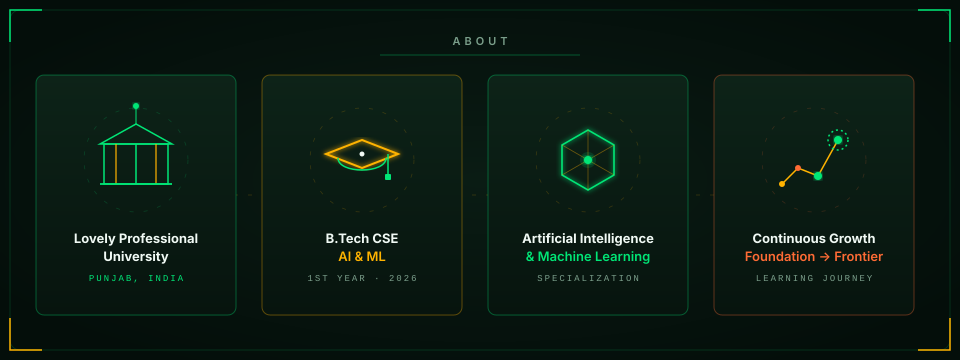
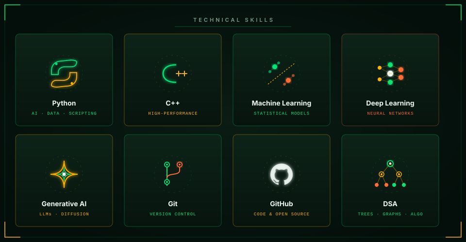
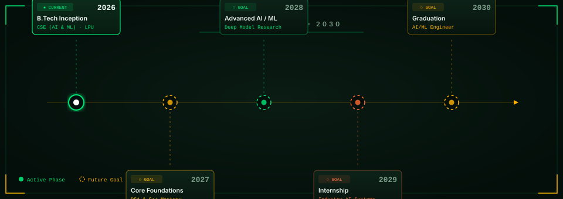

<!-- ==================== NAVIGATION HUD ==================== -->

  

<!-- ==================== HERO EXPERIENCE ==================== -->

 

<!-- ==================== SOCIAL MEDIA MATRIX ==================== -->

 

 

<!-- ==================== INTERACTIVE AI VISUALIZATION ==================== -->

 

 

<!-- ==================== ABOUT: VISUAL STORYTELLING ==================== -->

 

 

<!-- ==================== SKILLS: ANIMATED SVG ICONS ==================== -->

 

 

<!-- ==================== PROJECTS: ARCHITECTURE MATRIX ==================== -->

 

 

<!-- ==================== LEARNING TIMELINE: 2026-2030 ==================== -->

 

 

<!-- ==================== CONTACT CHANNELS ==================== -->

  

<!-- ==================== MINIMAL FOOTER TELEMETRY ==================== -->
<code>[SYSTEM] PRABHAKAR KUMAR // B.TECH CSE (AI &amp; ML) // LOVELY PROFESSIONAL UNIVERSITY // PUNJAB, INDIA</code>

